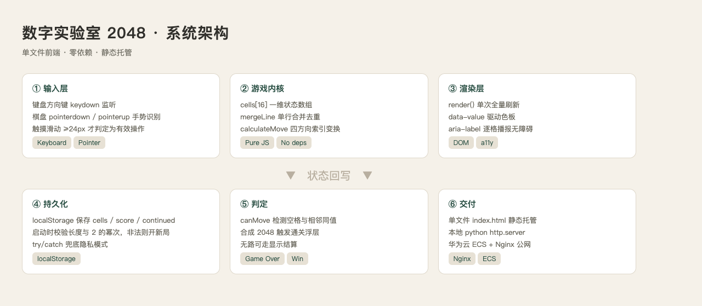

# 数字实验室 2048

一个纯单文件 HTML 的 2048 小游戏，零依赖、零构建，双击即可运行。

## 作品介绍

2048 是很多人都玩过的小游戏，规则简单但耐玩。这个作品的出发点很朴素：
用**一个文件**把它做完整——不引入任何 npm 包、不打包、不依赖框架，
打开 `index.html` 就能玩，也方便直接丢到任何静态服务器上。

界面走的是"实验室手账"的调子：米白纸感底色、低饱和的墨绿主色、
方块色阶从浅到深随数字递增，合成到 2048 时变成金色。
所有交互都收在 440px 的窄栏里，手机上单手也能玩。



## 功能

- 4×4 棋盘，方向键与触摸滑动双向操作
- 相同数字合并、翻倍计分，实时显示得分与历史最佳
- 无法移动时自动判定结束，合成 2048 触发通关提示
- 进度自动保存到 localStorage，刷新后继续上一局
- 响应式布局，适配 PC 与移动端
- 每格带 `aria-label` 播报，方向键操作有键盘焦点环

## 技术要点

单文件 `index.html`，CSS/JS 全部内联；无 npm、无打包、无外部依赖。

**状态模型**：整个游戏只有三个变量——`cells`（长度 16 的一维数组）、
`score`、`best`。棋盘用一维数组而不是二维，四方向的移动统一收敛到
"取索引序列 → 合并 → 写回"三步，避免写四套几乎相同的代码。

**合并算法**：`mergeLine` 先过滤掉空格，再从前往后扫描，
相邻同值就翻倍并入结果、指针跳一格。这样 `2,2,2,2` 会正确变成
`4,4`，而不是一路连锁合成 `8`——这是 2048 实现里最容易写错的地方。

**方向变换**：`calculateMove` 按方向生成四组索引，左右方向是行内正序/倒序，
上下方向是列内正序/倒序。倒序这一步让"向左合并"和"向右合并"复用同一个
`mergeLine`，省掉了一半分支。

**输入层**：键盘监听 `keydown` 并屏蔽输入框内的按键；
触摸用 pointer 事件而不是 touch 事件，因此鼠标拖拽也能玩；
位移小于 24px 视为误触，不触发移动。

**持久化**：每次 `render()` 末尾静默写入 localStorage。
启动时会把存档读回来做一轮校验——长度必须是 16、每个值要么是 0
要么是 2 的整数次幂，任何一项不满足就丢弃存档开新局，
避免手改 localStorage 导致的崩溃。读写都包了 try/catch，
隐私模式下存储不可用也能正常玩。

**渲染**：`render()` 是一次全量刷新，按 `data-value` 切换 CSS 类，
颜色全交给样式表，JS 里不出现任何颜色值。
动画只用了 CSS transition，没有引入动画库。

## 运行

直接用浏览器打开 `index.html`，或起一个静态服务：

```bash
python3 -m http.server 20480
```

## 部署

已部署于华为云 ECS（Huawei Cloud EulerOS 3.0 + Nginx 1.24），
公网地址 http://116.205.127.248/hc-activity/index.html

沙箱预览（DevBridge 隧道）：

```
https://yst3lmav-20480.devbridge-s2.hwtunnel.com
```

## 目录

```
work2048/
├── index.html              # 全部代码，CSS/JS 内联
├── README.md
└── resources/
    ├── architecture.png    # 系统架构图
    └── diagram.html        # 架构图源文件
```
